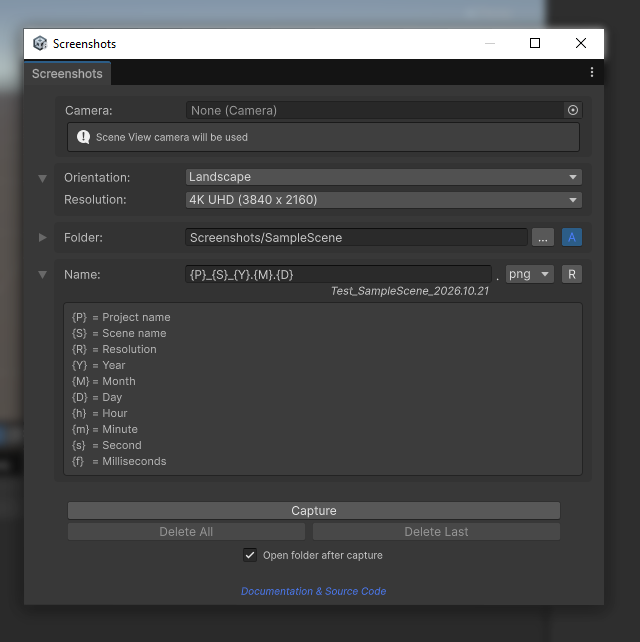
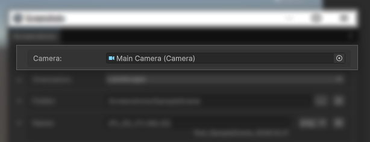
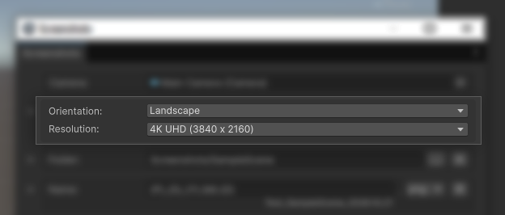
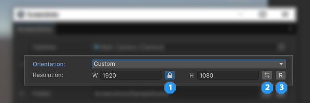
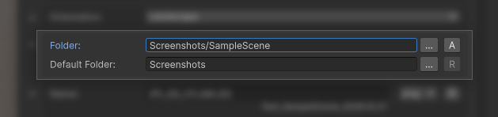
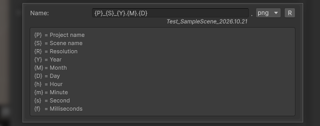
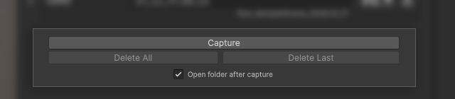

# Unity-Screenshots

 

A lightweight screenshot tool for Unity Editor. Capture high-resolution LDR and true 16-bit HDR screenshots of your game cameras and scenes directly from the editor.

## Requirements

* Unity 6 (6000.0) or newer.

## Installation

### Via Unity Asset Store

*(Link coming soon pending approval)*

### Via Unity Package Manager (Git URL)

1. Open Unity and go to `Window > Package Manager`.

2. Click the **\+** button in the top left corner and select **"Add package from git URL..."**.

3. Paste the following URL and click **Add**:

```
https://github.com/MUVITON/Unity-Screenshots.git?path=Package
```

## Quick Start

Open the tool by navigating to the top menu:

**`Tools > Screenshots`**

## Interface & Features



### 1\. Camera Source



Drag and drop any camera from your scene here. If left empty, the tool automatically uses your active **Scene View** camera and displays a helpful info box to let you know.

### 2\. Orientation & Resolution



Choose from a list of predefined popular device resolutions (e.g., iPhone Pro Max, Full HD, 4K). The Orientation dropdown offers three modes: **Landscape**, **Portrait**, and **Custom**.

#### 2.1 Custom Mode



When **Custom** orientation is selected, additional manual controls will dynamically appear:

1. **Aspect Ratio Lock:** Lock proportions while resizing.  
2. **Flip:** Quickly swap width and height.  
3. **Reset:** Return to default dimensions.

### 3\. Destination Folder

 

Configure where your screenshots are saved. Click the foldout arrow next to **Folder** to access the base path settings:

* **Folder (Active Path):** The actual directory where screenshots will be saved. Use **`[...]`** to pick any custom folder manually.
* **`[A]` (Auto-Generate Path):** Automatically builds the target path by taking your **Default Folder** and appending the active Scene or Prefab name as a subfolder (e.g., `Screenshots/SampleScene`).
* **Default Folder:** The root directory used by the **`[A]`** auto-mode. You can change it via **`[...]`** or click **`[R]`** to reset it back to the default `Screenshots` folder.

### 4\. Dynamic Naming & Formats



Create custom file names using built-in macros for project data (Project, Scene, Resolution) and timestamps. For example, `{P}_{S}_{R}` generates `MyProject_Level1_1920x1080`. 

A live preview below the input shows the exact result. You can also quickly select the output image format using the adjacent dropdown:
- **PNG / JPG / TGA:** For standard 8-bit LDR captures.
- **EXR:** For true 16-bit HDR captures (saved with lossless ZIP compression to save disk space).

### 5\. Action Panel



* **Capture:** Takes the screenshot with the specified settings.  
* **Delete All / Delete Last:** Quickly wipe recent screenshots if you're not satisfied with the result directly from the editor.  
* **Open folder after capture:** Check this box to automatically reveal and highlight the new screenshot in your OS file browser (Explorer/Finder) immediately after a successful capture.

## Credits & License

Developed by [Muviton](https://github.com/MUVITON).

Released under the MIT License.